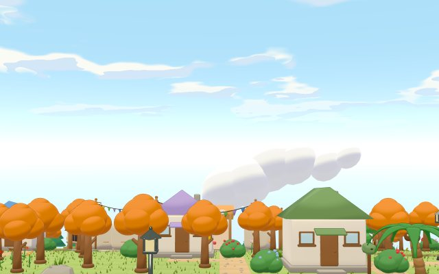

# 포근섬 이야기

웹 브라우저에서 설치 없이 바로 하는 **3D 섬 생활 게임** (오리지널 IP). 작은 섬에 이사 와서 채집하고, 주민과 친해지고, 집과 섬을 꾸미고, 계절 행사와 밤 시장을 즐깁니다. 화면 문구는 한국어입니다.



- **바로 하기**: https://claude.ai/artifact/73gDyHVhfveR7ESQ23JrbJ (claude.ai 아티팩트, 공개 링크 · 저장은 그 브라우저에)
- 모델은 모두 **Blender 스크립트로 만든 진짜 3D 모델**이고, 동물의 숲 같은 툰 셰이더를 입힙니다.

---

## 게임 플레이

| 조작 | 키보드 · 마우스 | 휴대폰 |
|---|---|---|
| 걷기 | WASD / 방향키 · 땅을 누르면 그 자리로, 꾹 누르면 커서를 따라감 | 왼쪽 가상 패드 |
| 행동 (줍기·말 걸기·문·흔들기) | Space / F | 오른쪽 단추 |
| 시점 올려다보기 | 오른쪽·가운데 버튼 끌기 · R / V | 두 손가락 |
| 섬폰 (도감·달력·시계·설정 등) | P / Esc | 섬폰 단추 |
| 가방 · 지도 | I 또는 Tab · M | 화면 단추 |
| 도구 바꾸기 | Q / E · 숫자 1–5 | 도구 단추 |

**하루의 흐름** — 게임 시각은 처음엔 실제보다 12배 빠르게 흐르고(게임 하루 = 실제 2시간, 실제와 같게 · 30배도 고를 수 있음, 닫아 두면 멈춤), 왼쪽 위 원형 시계의 바늘이나 −1·+1시간 단추로 바꿀 수 있습니다. 하루는 새벽 5시에 넘어갑니다. 낮에는 채집·상점·박물관, 저녁엔 곤충과 화석, 밤에는 야시장과 달빛 가게, 새벽엔 타로 천막이 열립니다.

**큰 흐름** — 섬 이름 정하기 → 첫날 안내(도구·채집·팔기·기증·집) → 주민 6명과 이모티콘 대화로 친해지기 → 축제 부품 다섯 모으기 → **섬 축제(엔딩)·단체 사진** → 그 뒤로 계절 행사 · 이사 오가기 · 무인도 여행 · 섬 꾸미기가 이어집니다.

## 구현한 것

| 마일스톤 | 내용 |
|---|---|
| M0–M4 기본 | 64×56 섬 생성(지형·물·절벽·경사로) · 곡면 월드 · 채집(나무·낚시·곤충·화석·꽃) · 도토리 경제 · 상점·박물관 · 내 집 꾸미기(가구·벽지·바닥) · 작업대 만들기 |
| M5 축제 | 이모티콘으로 주고받는 주민 대화 · 축제 부품·부스 놀이 다섯 · 축제 날 · 단체 사진 엔딩 · 해마다 축제 |
| M6 편집기 | 모든 리소스·값을 브라우저에서 고치는 편집기와 「요청 → 반영」 흐름 (아래 「편집기」) |
| M7 출시 준비 | 자동 플레이 QA · 기기 점검 `#check` · 휴대폰·접근성 · 저장 내보내기/불러오기 · 문제 알리기 · 하늘 셰이더 · 상점/박물관 실내 · 문 드나들기 · 그래픽 사양 4단계 |
| M8 계절 행사 | 봄 꽃놀이 · 여름 불꽃놀이 · 가을 수확 잔치 · 겨울 눈사람 날 (실제 날짜, 날짜 흉내 `#date=`) |
| M9 섬 꾸미기 | 섬 밖에 길 넷 · 울타리 둘 · 야외 가구 놓기 (이어지는 길·울타리, 주민 길찾기 반영) |
| M10 새 주민 | 새 주민 셋 · 엔딩 뒤 이사 오가기(떠나기는 물어보고 허락할 때만) · 앉기 · 꾸밈 옮기기 |
| 밤·새벽 | 토요일 야시장 · 달빛 가게(22–3시) · 새벽 타로 천막(3–5시, 하루 운세 효과) · 야행성 주민 |
| 무인도 투어 | 선착장에서 배 타고(배가 바다로 나가는 연출) 날마다 다른 무인도 → 희귀 과일·광석·물고기·곤충, 다른 섬 주민 초대 |
| 시계 · 배속 | 시간 빠르기 셋(×1 · ×12 · ×30) · 왼쪽 위 원형 시계 HUD(바늘 끌기 · −1/+1시간) · 섬폰 시계 (날짜는 앞으로만 — 하루치를 두 번 받지 않음) |
| M11 옷 | 모자 · 윗옷 · 신발 12벌 (색 변형 포함) · 상점 옷 진열대 · 옷장에서 갈아입기 · 입으면 빙글 · 섬 주민 12명까지 |
| 장면 | 컷신 22개 — 첫날 · 축제 · 계절 행사 · 이삿날 첫 만남 · 달빛 가게 · 새벽 천막 · 첫 섬 여행 |
| 다음 | 남은 일 모음 [`docs/notes/backlog.md`](docs/notes/backlog.md) · 일정 `docs/PLAN.md` 「앞으로 일정」 |

## 게임 시스템

- **모듈 구조** — `src/main.js` 가 `data → sky → world → player → ui → audio → gameplay` 차례로 모듈을 불러옵니다. 모듈끼리는 이벤트(`ctx.events`)와 서비스(`ctx.services.*`)로만 주고받고, 약속은 [`docs/CONTRACTS.md`](docs/CONTRACTS.md)에 있습니다.
- **행동 키 디스패처** — Space/F 하나를 우선순위로 나눕니다 (행사 할 일 > 말 걸기 > 문 > 가구 > 흔들기 > 줍기 > 도구).
- **저장** — `ctx.state` 칸마다 주인 모듈이 있고, `localStorage` 에 저장합니다. 하루 리셋은 05:00.
- **주민** — 주민 하나 = JSON 파일 하나(성격·말버릇·선물 반응·부탁·시간표·이모티콘 읽기 규칙·대사). 날씨·시각에 따라 집에 있거나 밖을 돌아다닙니다.
- **이야기** — 컷신도 데이터입니다(장면 = 카메라·배우·말풍선·연출안). 트리거가 맞으면 재생됩니다.
- **소리** — 소리 파일 없이 Web Audio 로 합성합니다(곡 = 악보 JSON, 효과음·목소리 표).
- **값은 데이터** — 아이템 값·출현 확률·상점·행사·밤·투어·이사 규칙·섬 지도가 모두 JSON 이라 코드를 고치지 않고 편집기에서 바꿉니다.

## 기술 스택

| 갈래 | 쓰는 것 |
|---|---|
| 게임 | **three.js 0.170** (importmap, 빌드 도구·npm 없음 — 브라우저 ES 모듈 그대로) |
| 셰이더 | 툰 명암 띠 · 외곽선 · **곡면 월드**(정점 셰이더 패치) · 하늘 셰이더(그라데이션·빛살·툰 구름·은하수) · 구름 그림자 · 물 하늘 반사 · 렌즈 빛 · 불꽃 |
| 모델 | **Blender 5.2 헤드리스 스크립트** — 스펙 JSON → 모델(.glb)·렌더. 캐릭터 15 · 배경 76 · 가구 50 · 아이템 103 · 옷 13 |
| 게시 | claude.ai 아티팩트 (CSP 안: `.glb` 대신 base64 `.glb.json`, 에셋은 묶음 JSON) |
| 점검 | `node --test` 규칙 테스트 460여 개 · 머리 없는 Chrome(CDP) 자동 플레이 봇 · 계절 행사 점검 |
| 로컬 서버 | `dev-server.mjs` (아티팩트와 같은 CSP · 편집기 저장소 흉내 `/api/db/*`) |

## 최적화

- **그래픽 사양 4단계** (매우 낮음 · 낮음 · 적정 · 높음) — 화소 배율 · 그림자 · 후처리 · 외곽선 · 초당 장수 · MSAA · 셰이더 갈래를 사양마다 켜고 끕니다. 처음엔 적정으로 시작하고, 느리면 저절로 한 칸씩 낮춥니다.
- **GPU 시간으로 재기** (`EXT_disjoint_timer_query_webgl2`, 느린 기기 기준인 Intel UHD 내장 그래픽, 도구 `tools/perf-bench.mjs`) — 광장 1280×800 낮 기준: 높음 10.5 · 적정 5.0 · 낮음 2.9 · 매우 낮음 1.8ms (2026-11-11 — 밤·투어·새 주민이 들어와도 11-06 과 ±0.1ms).
- **InstancedMesh + 칸별 컬링** — 나무·꽃·소품은 인스턴스로 그리고, 화면 밖 칸은 그리지 않습니다.
- **화면 밖 주민 쉬기** — 안 보이는 주민은 뼈대 애니메이션을 건너뛰고, 보일 때 밀린 시간을 한 번에 따라잡습니다.
- **에셋 묶음 · 나중에 받기** — 처음엔 섬·사람 묶음만 받고, 계절 행사·투어·섬 꾸미기·밤 건물·이사 오는 주민·옷 모델은 쓸 때 받습니다.
- **모델 줄이기** (게시 묶음만, `tools/glb-quantize.mjs`) — 법선 float×3 → byte×3, 뼈 가중치 float×4 → byte×4 (`KHR_mesh_quantization`, WASM 없이 three 가 그대로 읽음). 모델 22.6 → 17.3MB. 둘을 합쳐 **처음 받는 크기 11.5 → 6.1MB**, 전체 묶음 26.6 → 21.5MB (2026-11-11).
- **셰이더 미리 만들기** (`compileAsync`) · 하늘은 불투명 물체를 그린 뒤 빈 화소에만 칠하기.
- 자세한 측정과 고른 이유: [`docs/notes/p29-perf.md`](docs/notes/p29-perf.md) · [`docs/notes/p40-perf.md`](docs/notes/p40-perf.md)

## 편집기 (리소스 · 스토리 · 요소)

게임 안의 거의 모든 것을 브라우저 편집기에서 고치고, 고친 것은 「요청」으로 저장돼 채팅 명령 하나로 게임에 반영됩니다.

| 편집기 | 무엇을 | 반영 명령 |
|---|---|---|
| 리소스 편집기 | 모델·그림 전부 — 스펙 값 · 레퍼런스 · Blender 다시 빌드 / 로컬 생성 시험 / 만든 파일 교체 · 교체 약속 검사 · 예전↔지금 렌더 비교 | "리소스 요청 확인" |
| 스토리 편집기 | 장면 · 주민 성격·대사 · 편지 · 행사·밤·투어 글 | "스토리 반영" |
| 요소 편집기 | 상점 · 아이템 값 · 행사 · 밤 · 투어 · 이사 규칙 · 섬 지도 · 방 배치 | "요소 반영" |
| 곡 · 스타일 편집기 | 배경음·효과음·목소리 / 셰이더 값 | "소리 반영" · "스타일 반영" |

큰 결정과 새 리소스는 만들기 전에 **선택지가 있는 검수 보드**로 먼저 고릅니다(`concept/*-board.html`). 편집기 홈 `editors.html` 이 모든 편집기·보드·게임 링크와 「전체 관리」 표를 모읍니다.

## 실행 · 개발

```bash
node dev-server.mjs                       # http://localhost:4180/index.html
node --test tests/                        # 규칙 테스트 전체
node tools/playtest.mjs                   # 처음부터 엔딩까지 자동 플레이 (약 20분)
node tools/check-events.mjs --target=dev  # 계절 행사 넷 점검
node tools/build-web.mjs                  # 게시용 빌드 → dist/web/
node tools/build-character.mjs --all      # 캐릭터 모델 다시 만들기 (Blender 5.2 필요)
```

- 주소 끝 옵션: `?debug` (모듈·시간 패널) · `?quality=low` (사양) · `?check` (기기 점검) · `?date=2027-04-02` (날짜 흉내 — 따로 저장)
- 페이지: `/editors.html` 편집기 홈 · `/res-editor.html` · `/story-editor.html` · `/elem-editor.html` · `/concept/*-board.html` 검수 보드
- Node 22 이상. 모델을 다시 만들 때만 Blender 5.2 가 필요합니다 (`BLENDER` 환경변수로 경로 지정).

## 폴더

| 경로 | 내용 |
|---|---|
| `index.html`, `src/main.js` | 게임 시작점 · 모듈 로더 |
| `src/core/` | 이벤트 · 상태 · 입력 · 모델 불러오기 · 툰 재질·곡면 월드 |
| `src/world/` · `src/sky/` · `src/render/` | 섬·물체 · 시각·날씨·하늘 · 사양·후처리·컬링 |
| `src/gameplay/` | 채집 · 주민 · 집 · 이야기 · 축제 · 행사 · 섬 꾸미기 · 밤 · 투어 |
| `src/player/` | 주인공 · 카메라 · 마우스 걷기 · 옷 (`outfit.js`·`wear.js`) |
| `assets/` | 스펙 · Blender 빌더 · 모델 · 렌더 · 게임 데이터 JSON |
| `tools/` | 빌드 · 반영 도구 · 자동 플레이 실행기 |
| `tests/` | 규칙 테스트 · 자동 플레이 봇 (`tests/playthrough/`) |
| `concept/` | 검수 보드 |
| `docs/` | 개발 계획 `PLAN.md` · 모듈 약속 `CONTRACTS.md` · 셰이더 `SHADERS.md` · 트랙 노트 `notes/` · QA `qa/` |

개발 경위는 [`devlog.md`](devlog.md), 작업 규칙은 [`CLAUDE.md`](CLAUDE.md)에 있습니다.
