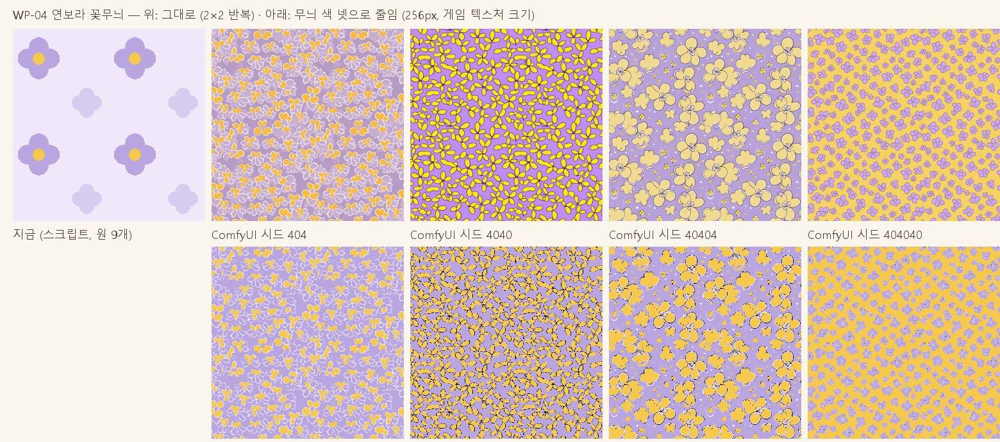

# 리소스를 로컬에서 다시 만들기 — Blender + 로컬 생성 모델 활용 안

2026-11-05 · 최적화 세션(`p29-perf`)에서 사용자 요청으로 정리. 이 저장소에는 리소스를 로컬·다른 모델로 바꾸는 문서가 따로 없어서 새로 만들었다. 지켜야 할 약속은 [CONTRACTS.md 「리소스 교체 약속」](../CONTRACTS.md), 지금 만드는 방법은 [CLAUDE.md 「에셋 파이프라인」](../../CLAUDE.md)에 있다.

---

## 1. 지금 방식 한눈에

```
스펙 JSON (assets/**/specs/<slug>.json: 비율·팔레트·변형·world 충돌)
  → Blender 5.2 헤드리스 빌더 (assets/blender/build_*.py + toonkit.py)
  → <slug>.glb · 렌더 · stats.json
  → tools/glb-to-json → <slug>.glb.json (base64, 아티팩트가 .glb 를 못 올려서)
  → 웹 빌드 묶음 packs/*.json (tools/build-web.mjs)
```

- **모두 스크립트로 처음부터 만든다** (`.blend` 는 커밋 안 함 → 언제든 다시 만들 수 있다). 사람 손 모델링·외부 모델은 아직 없다.
- 지금 크기 (삼각형, 가운데 값 / 가장 큰 것): 캐릭터 10종 10.6k / 11.8k · 배경 60종 1.4k / 6.5k · 가구 38종 2.8k / 7.7k · 아이템 90종 1.5k / 5.2k.
- 게임이 모델에 바라는 것 (바꿔 끼울 때 꼭 맞춰야 하는 것):
  | 약속 | 왜 |
  |---|---|
  | **재질 이름 = 스펙 팔레트 키** (`glow`·`window`·`grass`·`eye` …) | 밤 불빛·비 젖음·외곽선 제외·하이라이트가 이름으로 걸린다 |
  | 단색 재질(텍스처 없음), 툰 셰이더용 | `materials.applyToonStyle` 이 색만 받아 명암 띠를 만든다 |
  | 크기 타일 1칸 = 1.0, 캐릭터 키 ≈ 1.0, Blender Z-up · 정면 -Y, 원점 = 바닥 가운데 | 배치·충돌·카메라가 이 크기를 가정한다 |
  | 캐릭터: 같은 뼈 이름·동작 이름(idle·walk·run·…) | `town/actor.js`·`player` 가 동작 이름으로 튼다 |
  | 배경: 스펙 `world.collider`·`extent`·`lot` 이 모델 크기와 맞음 | `tests/assets.test.mjs` 가 검사 |
  | 삼각형 예산 (위 표 근처) | 이 개발 PC 브라우저는 Intel UHD 로 돈다 — 느린 기기 기준 |

---

## 2. 이 컴퓨터에서 쓸 수 있는 것

| 것 | 상태 | 쓸 곳 |
|---|---|---|
| Blender 5.2 | 설치됨, 빌더 4개가 씀 | 모든 모델의 마지막 손질·내보내기 |
| **NVIDIA RTX 4080 Laptop (12GB)** | 있음 (게임 브라우저는 Intel UHD 를 씀) | 로컬 그림·3D 생성 |
| ComfyUI (portable) | `../_tools/ComfyUI_windows_portable` 설치됨, `ComfyUI-seamless-tiling` 노드 내려받음 | 컨셉 그림·이음매 없는 무늬 |
| Animagine XL 4.0 파이프라인 | 말벗 라운지(`../character-chat/tools/imagegen/`)에서 씀 | 캐릭터 컨셉 시트 (게임 그림체와는 다름) |
| glTF-Transform · meshoptimizer | 이번에 scratch 에서 시험 (저장소에는 안 넣음) | 모델 압축·정리 |

---

## 3. 갈래별 추천

### A. 지금처럼 Blender 스크립트로 (추천: 캐릭터·건물·타일·대부분의 소품)
- 장점: 모양이 모두 같은 그림체로 맞고, 팔레트·재질 이름·충돌이 처음부터 약속대로 나온다. 고치기 = 스펙 숫자 바꾸고 다시 빌드 (편집기 「요청 확인」 흐름이 이미 이걸 씀).
- 약점: 둥근 생물·복잡한 모양(동물 주민 얼굴, 꽃 세부)은 스크립트로 표현하기 어렵다.
- 보완: 빌더에 **모양 조각 라이브러리**(귀·꼬리·잎·지붕 같은 부품 함수)를 늘리고, 스펙에 부품을 고르는 칸을 더한다.

### B. 로컬 이미지 생성 → 레퍼런스·무늬 (추천: 컨셉 단계·벽지/바닥/땅 무늬)
- ComfyUI 로 **검수 보드 선택지 그림**(같은 요소의 A·B·C 안)을 뽑아 보드에 올리고, 고른 안을 보고 스펙 숫자를 맞춘다 — 지금 「레퍼런스 → 요청」 흐름에 그대로 들어간다.
- 실내 무늬(`wp-0N`·`fl-0N`)와 땅 타일 색 변화는 `seamless-tiling` 노드로 이음매 없는 그림 → **색 4~6개로 줄여** 팔레트에 맞춘 뒤 쓰면 툰 그림체를 깨지 않는다. (지금 게임은 텍스처를 거의 안 써서, 넣으면 묶음 크기가 는다 — 256px 이하 권장)
- 캐릭터 컨셉 시트(앞·옆·뒤)는 Blender 스펙 비율을 정할 때 기준 그림으로만 쓴다.

### C. 로컬 이미지 → 3D 생성 → Blender 손질 (추천: 가구·아이템·자연물처럼 뼈 없는 것만)
- 후보: **Hunyuan3D-2.1** (모양만 약 10GB → 12GB 에 들어감, 텍스처 단계는 약 21GB 라 이 PC 에선 안 됨), **TRELLIS** (16GB 이상 권장 → 빠듯함). 둘 다 ComfyUI 노드가 있다. 결과는 수만~수십만 삼각형의 높은 해상도 모양 + (안 쓸) 텍스처.
- 툰 그림체에 맞추려면 **텍스처는 버리고 모양만** 가져와 Blender 에서 다시 칠한다 — 이 PC 에서 안 되는 텍스처 단계가 필요 없어진다.
- 새 빌더 `assets/blender/build_import.py` (제안) 순서:
  1. 생성 결과 `.glb`/`.obj` 불러오기 (`assets/<분류>/sources/<slug>.glb`, 원본은 커밋하지 않고 `source` 칸에 생성 조건만 기록)
  2. 크기 맞추기: 스펙 `footprint`·높이에 맞춰 늘이고, 원점 = 바닥 가운데, 정면 -Y
  3. 줄이기: Decimate(비율) 또는 Voxel Remesh → Decimate 로 분류 예산(위 표)까지 · 평평한 면 합치기
  4. 칠하기: 면을 높이·방향·원래 색으로 묶어 **팔레트 키 재질**로 나눠 붙인다 (예: 위쪽 = `leaf`, 아래 = `trunk`) — 규칙은 스펙에 `regions` 로
  5. 외곽선·툰이 잘 먹게 법선 정리(Auto Smooth 각도), 아주 작은 조각 지우기
  6. 기존 내보내기 그대로 (`.glb` → `.glb.json`, 렌더, stats) → 편집기·게임은 바뀐 줄 모른다
- 스펙에 `"source": { "kind": "import", "generator": "hunyuan3d-2.1", "image": "…", "seed": 123, "decimate": 0.04 }` 를 두면 「요청 확인」 때 같은 결과를 다시 만들 수 있다.
- **캐릭터에는 쓰지 않기**: 자동 뼈 심기(리깅)가 지금 뼈 이름·동작과 맞지 않아 걷기·표정이 깨진다. 캐릭터는 A 로 두고, 생성 모델은 얼굴·귀 같은 부품 모양 참고로만.

### D. 다른(외부) 모델·서비스를 쓸 때
- Meshy·Tripo 같은 유료 클라우드 생성기는 결과가 좋지만 로컬이 아니고, **이용 약관상 상업 사용·재배포 조건**을 리소스마다 확인해야 한다 (오리지널 IP 게임이라 남의 에셋·이름은 쓰지 않는다는 원칙 그대로).
- 무료 에셋 사이트(Poly Haven 등, CC0)는 실사 그림체라 그대로는 안 맞는다 → C 와 같은 손질 순서를 거친다.
- 어느 쪽이든 **들어오는 길은 하나**: 스펙 + 빌더 → `.glb.json`. 게임 코드는 바꾸지 않는다.

### E. Blender 를 대화로 조작하는 MCP (선택)
- `blender-mcp`(ahujasid, MIT): Blender 안에 애드온을 켜면 Claude 가 장면을 보고 파이썬을 실행한다. 한 모델을 눈으로 보며 다듬을 때 편하다.
- 하지만 이 프로젝트는 **다시 만들 수 있는 스크립트**가 원칙이라, MCP 로 고친 것은 결국 스펙·빌더에 옮겨 적어야 한다. 지금은 헤드리스 빌더 + 렌더 그림 확인으로 충분해서 **설치는 미룸**(필요해지면 그때).

---

## 4. 추천 순서 (P 번호는 사용자가 정한 뒤)

| 차례 | 할 일 | 누가 | 결과 |
|---|---|---|---|
| 1 | ComfyUI 로 다음 차수 검수 보드의 선택지 그림 만들기 (B) | Claude | 보드 그림이 실제 후보 모습 |
| 2 | 실내 무늬 16종을 이음매 없는 그림 + 팔레트 줄이기로 시험 하나 (B) | Claude → 사용자 검수 | 무늬 하나 비교 화면 |
| 3 | ComfyUI 에 Hunyuan3D-2.1 모양 노드 설치 → 가구 하나(예: 소파)로 C 순서 시험 | Claude (설치 = 큰 내려받기, 사용자 승인) | 지금 모델과 나란히 렌더 비교 |
| 4 | 3 이 좋으면 `build_import.py` + 스펙 `source`·`regions` 칸 + 테스트 | Claude | 가구·아이템·자연물 교체 길 |
| 5 | 캐릭터는 A 유지, 부품 라이브러리만 늘리기 | Claude | 주민 모양 다양하게 |

---

## 5. 사용자가 할 것

- 3번의 큰 내려받기(모델 가중치 수 GB) 승인.
- 시험 결과(렌더 비교)를 보고 "이 그림체로 바꿔도 된다/안 된다" 고르기 — 보드 선택지로 올린다.
- 외부 유료 생성기를 쓸 생각이면 어느 서비스인지와 약관 확인.

---

## 6. 최적화와의 관계 (이번 세션에서 잰 것)

- 모델을 **meshopt 로 압축**하면 원본 크기가 반(15.3 → 7.5MB), 전송(gzip) 기준 약 −31% 이다. 그러나 풀 때 WebAssembly 가 필요한데 **아티팩트 CSP 에 `wasm-unsafe-eval` 이 없어** 게시본에서는 못 쓴다 → 나중에 자체 웹 서비스로 옮기면 1순위.
- 양자화만(WASM 필요 없음)은 gzip 뒤 크기가 거의 같아서 안 함.
- 새로 만드는 모델이 위 삼각형 예산을 넘으면 게임 전체가 느려진다 — C 갈래의 줄이기 단계가 가장 중요하다.

---

## 7. M9-P4 시험 결과 — 무늬 하나 로컬 그림 비교 (9차 보드 D88-A, 2026-11-08)



- **대상**: WP-04 연보라 꽃무늬 (`assets/interior/specs/wp-04.json`, 원 9개로 그린 한 칸 26×26 → 0.55m).
- **로컬 그림**: 이미 깔린 ComfyUI 0.42.1 (`../_tools/ComfyUI_windows_portable`) + `sd_xl_base_1.0` + `ComfyUI-seamless-tiling` (`SeamlessTile` 모델 타일링 + `CircularVAEDecode`). **새로 받은 모델 없음**. RTX 4080 Laptop 12GB 에서 1024², 28단계 dpmpp_2m karras, cfg 6.5 — 한 장 약 14초 (처음 한 장은 모델 올리기 포함 32초). 프롬프트: "seamless repeating wallpaper pattern, small cute lavender five-petal flowers with yellow round centers, … flat vector, simple shapes, evenly spaced, cozy children picture book style". 시드 404 · 4040 · 40404 · 404040.
- **색 줄이기**: 256px 로 줄인 뒤 무늬 팔레트 넷(base `#EFE8FA` · petal `#B9A6E0` · petalLight `#D7CCF0` · heart `#F6C84C`)의 가장 가까운 색으로, 디더 없이 (PIL quantize). 결과 PNG 11–17KB (스크립트 무늬는 그림 파일 없이 캔버스로 그려 0KB).
- **이음매**: 네 장 모두 2×2 로 이어 붙여도 이음매가 보이지 않는다 (타일링 노드는 잘 된다).
- **그림체**: 스크립트 무늬보다 **훨씬 빽빽하고 노랑이 많으며**, 색을 넷으로 줄이면 꽃 가장자리·외곽선이 자글자글한 점으로 남는다(4040·40404). 404 (흰 꽃잎 테두리)가 가장 가깝지만 그래도 방 안에서 보면 무늬가 시끄럽다. 게임의 다른 것(단색 툰·큰 덩어리)과 나란히 두면 스크립트 무늬 쪽이 어울린다.
- **결론 (추천)**: 실내 무늬는 **지금처럼 스크립트(스펙 도형)로** 둔다. 로컬 그림은 (1) 검수 보드 선택지·레퍼런스 그림, (2) 사람이 보고 도형 좌표로 옮겨 그릴 밑그림으로 쓴다. 텍스처로 직접 넣으려면 SDXL 기본 모델 대신 납작한 벡터 그림체 LoRA 가 필요하고(큰 내려받기 → 사용자 승인), 무늬 칸 크기를 2–3배 크게 잡아야 한다.
- 다시 해 보기: 그리기 스크립트·색 줄이기 스크립트는 저장소에 넣지 않았다 (위 조건으로 ComfyUI API `/prompt` 에 노드 8개 — CheckpointLoaderSimple → SeamlessTile → CLIPTextEncode×2 → EmptyLatentImage → KSampler → CircularVAEDecode → SaveImage).
